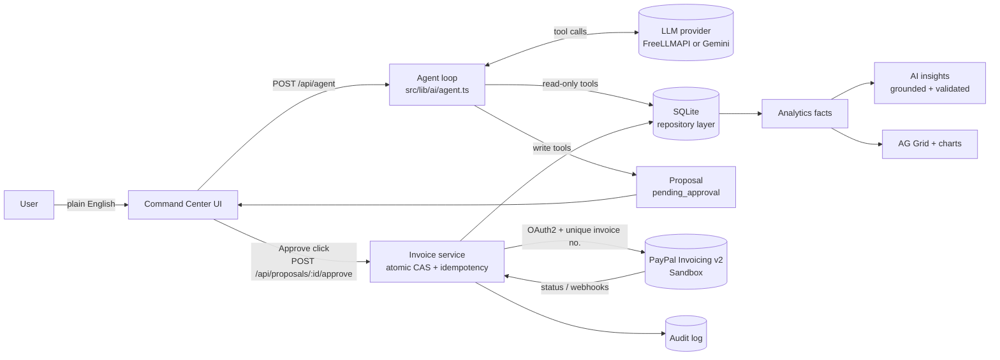

# NEXORA AI — the invoicing co-pilot for freelancers billing the world

> Say who owes you. Approve the invoice. PayPal does the rest.

NEXORA turns a plain-English request into a **real PayPal invoice**. An AI agent drafts it, asks when something is missing, and **waits for your approval**. Only then does the server create and send the invoice through the **PayPal Invoicing v2 API (Sandbox)**. Payment status syncs back from PayPal, and an analytics dashboard (AG Grid + charts) explains your receivables with AI insights that cite only your own numbers.

Built for the **PayPal AI Hackathon 2026**. Sandbox only. MIT licensed.

---

## The problem

Freelancers and small studios billing international clients lose hours to invoicing admin: re-typing client details, converting currencies and tax rates, remembering who's late, writing awkward reminder emails. Generic AI chatbots can write an invoice, but they can't **send** one safely: they guess email addresses, invent numbers and act without asking.

## The solution

| You do | NEXORA does |
|---|---|
| Type *"Bill Acme Corp $800 for the landing page redesign, due in 14 days."* | Extracts client, line items, currency, tax and due date; looks up the client; asks for the email if it's unknown |
| Review the invoice slip; edit anything | Validates currency, amounts (integer minor units), tax and due dates on the server |
| Click **Approve & send via PayPal** | Creates the PayPal invoice, sends it (idempotent), confirms its real status from PayPal |
| Open **Analytics** | Computes outstanding, overdue, aging, days-to-pay; AI explains it, citing only computed figures |
| Click **Draft reminder with AI**, then approve | Writes a polite reminder; PayPal sends it only after your click |

## Features

- **Agentic invoice drafting** with six typed tools: `draft_invoice`, `find_client`, `list_invoices`, `get_invoice_status`, `summarize_receivables`, `draft_reminder`.
- **Human-in-the-loop by construction.** Write tools only create a proposal with status `pending_approval`. The single PayPal write path is `POST /api/proposals/:id/approve`, triggered by the user's click. The agent can't reach it.
- **Never guesses an email.** `draft_invoice` rejects any email that the user didn't type and that isn't a saved client. The model is told to ask.
- **Real PayPal Sandbox integration:** create draft → send → get status → remind → cancel, plus verified webhooks.
- **Idempotency without trusting one mechanism:** (1) an atomic compare-and-set on the proposal row, so double clicks and concurrent requests execute once; (2) a deterministic PayPal invoice number per proposal (`NX-…`), so if PayPal created the invoice but the response was lost, a retry finds it with `search-invoices` instead of creating a duplicate; (3) `PayPal-Request-Id` sent on every write as defense in depth (the Invoicing v2 spec does not document it, so we don't rely on it). A failed send resumes from the stored PayPal invoice.
- **Status sync** via refresh button, polling while invoices are open, and (optionally) PayPal webhooks with signature verification.
- **Analytics** with AG Grid Community (sort, filter, quick search), billed-vs-collected and aging charts, a labeled **Estimate** for next-30-day collections, and **grounded AI insights**. Insights must cite fact keys, and any insight quoting an amount not in the data is discarded.
- **Configurable tax** (name + percent, workspace default or per invoice), 25 PayPal currencies including zero-decimal JPY/HUF/TWD.
- **Audit log** of every AI proposal, approval and PayPal call (endpoint, HTTP status, PayPal debug ID, invoice ID). Secrets are redacted.
- **Data honesty.** Demo rows are `source='demo'` and labeled *Demo data*. Mock-mode rows are labeled *Mock PayPal*. Real ones show *PayPal Sandbox* and the real `INV2-…` ID. A sandbox badge is on every screen.
- **Provider-agnostic AI:** FreeLLMAPI (default, OpenAI-compatible local router) or Google Gemini via `@google/genai`. Adding another provider means one file.

## Architecture



A modular monolith on Next.js 15 (App Router, TypeScript strict):

```
src/lib/
  ai/          provider.ts (interface), openai-compatible.ts (FreeLLMAPI), gemini.ts,
               tools.ts, agent.ts, insights.ts, reminder.ts, scripted.ts (tests only)
  paypal/      client.ts (OAuth cache, endpoints, errors), mock.ts (dev/E2E), types.ts
  invoices/    schema.ts (zod + normalization), service.ts (approve/sync), demo.ts
  analytics/   deterministic facts from the DB
  db/          better-sqlite3, migrations, repository functions (org-scoped)
  audit/       append-only audit log with redaction
  env.ts       zod-validated env + sandbox guard + setup checklist
```

## PayPal integration

Endpoints verified against PayPal's official OpenAPI spec ([paypal-rest-api-specifications](https://github.com/paypal/paypal-rest-api-specifications), `invoicing_v2.json`):

| Purpose | Call |
|---|---|
| Auth | `POST /v1/oauth2/token` (client credentials; cached until 60 s before expiry; single-flight) |
| Create draft | `POST /v2/invoicing/invoices` with `Prefer: return=representation` and a deterministic `detail.invoice_number` |
| Recover | `POST /v2/invoicing/search-invoices` by invoice number (after a lost response / `DUPLICATE_INVOICE_NUMBER`) |
| Send | `POST /v2/invoicing/invoices/{id}/send` |
| Status | `GET /v2/invoicing/invoices/{id}` (source of truth for status, totals and paid amount) |
| Reminder | `POST /v2/invoicing/invoices/{id}/remind` (only after approval; status re-checked first) |
| Cancel | `POST /v2/invoicing/invoices/{id}/cancel` |
| Webhooks | `POST /v1/notifications/verify-webhook-signature`, then re-fetch the invoice |

- **Server-side only.** Credentials never reach the browser.
- **Sandbox guard:** the server refuses to start if `PAYPAL_BASE_URL` isn't `https://api-m.sandbox.paypal.com` (unless `PAYPAL_ALLOW_LIVE=true`).
- Amounts are integers in minor units in the DB and exact decimal strings for PayPal (`"800.00"`, `"1500"` for JPY).
- PayPal errors are mapped to readable messages; the PayPal **debug ID** is logged and shown.

## AI design

- **Interface:** `AIProvider.generate({ system, messages, tools?, jsonSchema? })` → `{ text, toolCalls, raw }`. Gemini's raw turn is replayed verbatim to preserve thought signatures across tool calls.
- **Loop:** up to 6 steps. Tool arguments are validated with zod. Unknown tools, malformed JSON and validation errors go back to the model as tool errors so it can self-correct. Refusals, timeouts, rate limits and auth errors map to clear UI messages.
- **Approval gating:** write tools return `pending_approval` proposals; execution lives in a separate endpoint.
- **Grounded insights:** the server computes facts, the model must cite fact keys, and output is validated with zod. Insights quoting amounts that don't appear in the facts are dropped, and the UI shows the figures each insight used.
- **No fake AI:** with no key configured, the UI shows *AI not configured*. The scripted provider exists only for automated tests and is labeled as such.
- Rate limits: 20 agent requests/min, 6 insight requests/min, 8 login attempts/min.

## Run it locally

Requirements: Node 20+ (22 recommended), a free [PayPal Developer](https://developer.paypal.com/) account, and an AI key (FreeLLMAPI or Gemini).

```bash
git clone <this repo> nexora-ai && cd nexora-ai
npm install
cp .env.example .env.local   # then fill it in (see below)
npm run build && npm start   # or: npm run dev
```

Open http://localhost:3000 and sign in with your `APP_PASSCODE`. `/setup` lists anything missing (it never shows values).

### `.env.local`

| Variable | Notes |
|---|---|
| `PAYPAL_CLIENT_ID`, `PAYPAL_CLIENT_SECRET` | developer.paypal.com → Apps & Credentials → **Sandbox** → Create App |
| `PAYPAL_BASE_URL` | `https://api-m.sandbox.paypal.com` (enforced) |
| `AI_PROVIDER` | `freellmapi` (default) or `gemini` |
| `FREELLMAPI_BASE_URL`, `FREELLMAPI_API_KEY`, `FREELLMAPI_MODEL` | Local [FreeLLMAPI](https://github.com/tashfeenahmed/freellmapi) router (`http://localhost:3001/v1`, model `auto:smart`) |
| `GEMINI_API_KEY`, `AI_MODEL`, `AI_THINKING_LEVEL` | Google AI Studio key; `gemini-3.5-flash` or `gemini-3.5-flash-lite`; thinking `low` (recommended for speed) |
| `APP_PASSCODE` | ≥ 6 characters |
| `DATABASE_PATH` | default `./data/nexora.db` |
| `PAYPAL_WEBHOOK_ID` | optional; enables `/api/webhooks/paypal` |

### Choosing a Gemini model (free tier)

Measured on a free-tier Google AI Studio key (Nov 2026):

| Model | Free-tier quota | Agent turn latency (thinking `low`) |
|---|---|---|
| `gemini-3.5-flash-lite` | 15 requests / minute | ~2–4 s |
| `gemini-3.5-flash` | 20 requests / **day** | ~20–50 s at default thinking |

One agent turn uses 1–3 model requests. For demos and judging use **`gemini-3.5-flash-lite`** with `AI_THINKING_LEVEL=low`, or a billed key. `gemini-2.5-*` models return 404 for new keys. When a quota is hit, NEXORA says which one and how long to wait.

### Sandbox test accounts

1. In the PayPal Developer Dashboard, open **Testing Tools → Sandbox Accounts**. You get a default **Business** account (the invoicer, tied to your REST app) and a **Personal** account (a payer).
2. Use the Personal account's email as the client email when you bill someone in NEXORA. PayPal Sandbox "sends" the invoice to that account's notifications.
3. To pay: open the invoice's **payer view** (link on the invoice detail page), log in with the Personal sandbox account (password under *View/Edit account*), and pay. Click **Refresh status from PayPal** in NEXORA and the status changes to *Paid*.

## Judge testing steps

1. Sign in → **Settings → Load demo data** (15 labeled sample invoices for the dashboard).
2. **Command Center:** type `Bill Acme Corp $800 for the landing page redesign, due in 14 days.` NEXORA asks for the email (it never guesses).
3. Reply with your **Personal sandbox account email**. An invoice slip appears. Try **Edit** (change the amount or tax), then **Approve & send via PayPal**.
4. The slip is stamped *SENT* and shows the real `INV2-…` PayPal ID. Click **Track payment**.
5. On the invoice page: **Refresh status from PayPal**, open the payer view, pay with the sandbox buyer, refresh again to see *Paid*.
6. For an unpaid invoice: **Draft reminder with AI** → review → **Approve & send reminder**.
7. **Analytics:** toggle demo data, sort/filter the AG Grid, click **Explain my receivables**.
8. **Activity log:** every AI proposal, your approvals and each PayPal call with HTTP status and debug ID.

## Tests

```bash
npm test               # Vitest: money, schemas, AI parsing, PayPal client (mocked HTTP), idempotency, approval gating
npm run test:e2e       # Playwright: full flow against a production build (mock PayPal + scripted provider)
npm run test:sandbox   # opt-in: real PayPal Sandbox create → send → get → remind → cancel
npm run check:paypal   # read-only: OAuth token + list invoices (creates nothing)
NEXORA_URL=http://localhost:3000 NEXORA_PASSCODE=... npm run check:live-agent  # real AI, 12 checks
NEXORA_URL=http://localhost:3000 NEXORA_PASSCODE=... npm run check:ui-live     # real AI in Chromium + screenshots
npm run lint && npm run build
```

See [TESTING.md](TESTING.md) for what is verified against the real Sandbox and what is tested with mocks.

## Limitations

- Single-user passcode auth (queries are still scoped by org ID, ready for multi-tenant).
- SQLite on a single instance; in-memory rate limiting. The repository layer is ready for Postgres.
- Analytics sum only the most common currency; other currencies are counted and flagged, not converted.
- FreeLLMAPI runs on localhost, so a hosted deployment uses Gemini.
- PayPal Sandbox only, by design.

## Roadmap

See [ROADMAP.md](ROADMAP.md): CRM, recurring invoices and subscriptions, multi-agent collections, teams and roles, a dispute assistant, and a workflow builder.

## License

[MIT](LICENSE)
